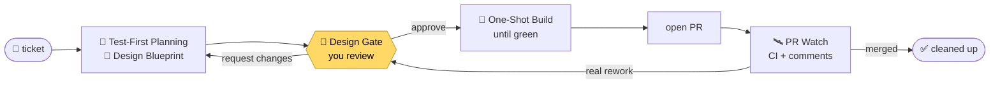

<div align="center">

# ℞ pi-rx

### Ticket in, merged PR out, and you approve the design before any code is written.

<p>
  
  
  
  
  <a href="./LICENSE"></a>
</p>

<p>
  <a href="#-get-started"><b>Get started</b></a> ·
  <a href="#-how-a-ticket-flows">How it flows</a> ·
  <a href="#-why-its-opinionated">Why</a> ·
  <a href="#-customize">Customize</a> ·
  <a href="#-commands">Commands</a>
</p>

</div>

**Rx is a workflow extension for the [pi](https://pi.dev) and omp coding agents, built for one-shot
development.** Give it a ticket (Linear, Jira, GitHub, GitLab) or just describe a task, and the agent
takes it all the way to a merged pull request:

**🧪 Test-First Planning** → **📐 Design Blueprint** → **🚦 Design Gate** → **🎯 One-Shot Build** → **🛰️ PR Watch**

You stay in charge of *what* gets built at the gate. The agent handles the rest.

## 🚀 Get started

```bash
pi install git:github.com/sdsvn/pi-rx       # pi
omp plugin install github:sdsvn/pi-rx       # or omp
```

Then, in any git repository:

```text
/rx ENG-1234                          # a Linear ticket (or its URL)
/rx #123                              # a GitHub issue
/rx add retry to the webhook sender   # or just say what you want
```

That's it. `/rx` sees where the ticket is and runs the next step. You need `git` and a signed-in
`gh`; everything else is [optional](#-customize). Using Jira or GitLab?
[One line of config](#-ticket-sources).

## 📖 Why it's opinionated

Coding agents are eager. Hand one a ticket and it starts writing code right away, and if its
approach is off, you only find out by reading the diff. Then the back-and-forth starts: fix this, not
like that, undo that part. The code is rarely the real problem. **The plan is, and you only get to see
it after it has been turned into code.**

So Rx flips the order. Before writing a single line, the agent has to:

1. **Write the test plan first.** Deciding up front how the change will be proven changes how the agent
   writes it. It knows the edge cases, the failure paths, and what "done" means before it starts, and
   the code comes out shaped to pass those tests rather than patched until it does.
2. **Write the design as plain-language pseudocode**, a tree you can read in a minute, and show it to
   you.

You argue with the plan while it's cheap to change. Once you approve it, the agent implements against
something both of you agreed on.

In my experience that's the difference: **tasks now land in almost a single shot.** The review that
used to happen across five rounds of diffs happens once, on one page, before any code exists.

That's also why Rx is opinionated. It works because of the order it insists on: test plan, design,
your approval, then code. It isn't a loose toolkit you assemble yourself.

## 🩺 What it does

Rx sets up an isolated worktree, plans the tests, and writes a **Design Blueprint** (plain-language
pseudocode), then stops at the **Design Gate**. Nothing gets implemented until you approve it. After
that comes the **One-Shot Build**, the PR, and **PR Watch** on CI and review comments until it merges.



> [!NOTE]
> Rx also works best with a handful of tools ([Co-Review](https://sdsvn.github.io/co-review/), [Herdr](https://herdr.dev/), [ntfy.sh](https://ntfy.sh) and others). **None of them are
> required**: without each one, Rx falls back to something simpler. See [Customize](#-customize).

## ✨ What you get

|   |   |
|---|---|
| 🎯 **One-shot development** | The plan is settled before any code exists, so the build lands in one pass instead of round after round of "not like that". |
| 🧪 **Test-First Planning** | The agent decides how the change will be proven before it designs it, so it knows the edge cases and what "done" means up front. |
| 🚦 **A real Design Gate** | You review a plain-language Design Blueprint, not just the diff. Every phase change goes through one guarded tool that refuses invalid jumps, so the agent can't skip the gate. |
| 🧹 **Nothing lands in your project** | State, design docs, and specs live under `~/.claude/workflow/`, keyed per repository. Rx never writes to your repo. |
| 🔌 **Works with your tracker** | Linear, Jira, GitHub and GitLab built in. Name yours in one line of config, or teach Rx a new one with a short markdown file. |
| 📈 **Learning Loop** | Every rejection, rework, and requested change is logged with its reason. `/rx-retro` turns patterns into workflow fixes. |
| 🪶 **Tiny footprint** | One TypeScript file plus markdown playbooks. No dependencies, no build: pi and omp run the source. |

## 🔄 How a ticket flows

**1 · 🧪 Test-First Planning.** Creates `.worktrees/ENG-1234` on branch `ENG-1234`, reads the ticket, and writes a test
plan, then a **Design Blueprint** (pseudocode) and, with [OpenSpec](https://openspec.dev/), spec deltas.
It writes no code.

**2 · 🚦 Design Gate.** The blueprint opens for you as soon as it's ready:

- **In Co-Review**, if it's installed: comment on any step, get answers in the thread, and Submit with
  *Approve* or *Request changes*.
- **As a local HTML page** otherwise, with comment buttons, *Approve*, and *Request changes*.

Your comments go straight to the agent. It answers questions and edits the design, and the review
updates live. *Request changes* (or `/rx-reject ENG-1234 "why"`) starts another round.

**3 · 🎯 One-Shot Build.** *Approve* (or `/rx-approve`) implements against the approved design and runs the
verification loop until it's green.

**4 · 🛰️ PR Watch.** `/rx-pr` opens the pull request. Inside [Herdr](https://herdr.dev/), a watcher then keeps an eye on it: it fixes
red CI and trivial comments itself, answers threads, and sends real changes back to the Design Gate
with `/rx-rework`.

**5 · 🧹 Clean up.** Once merged, `/rx-cleanup` removes the worktree, branch, watcher, and artifacts, and
archives the spec deltas.

> [!TIP]
> Changed your mind? `/rx-abort ENG-1234` abandons a ticket at any phase and tears everything down.

## ⌨️ Commands

| Command | |
|---|---|
| `/rx [ticket \| url \| text]` | **Run the next step.** Bare `/rx` drives the current ticket. Inside Herdr, it gives every active ticket its own workspace. `/rx approve`, `/rx status`, `/rx reject "why"`… run that step on the current ticket. |
| `/rx-review` | Reopen the design review (it opens by itself at the gate). |
| `/rx-approve` · `/rx-reject "notes"` | Approve the design, or push back on it. |
| `/rx-rework "summary"` | The PR needs real changes: back to the design gate. |
| `/rx-abort` | Abandon the ticket at any phase. |
| `/rx-status` | Every ticket in this repo, at a glance. |

<details>
<summary><b>All commands</b></summary>

<br>

| Command | What it does |
|---|---|
| `/rx-start` | Worktree, test plan, and design; stops at the approval gate. |
| `/rx-pr` | Open the PR, or push a rework to the existing one. |
| `/rx-cleanup` | After merge: tear down and archive. |
| `/rx-retro` | Find recurring corrections in the deviation log. |
| `/rx-improve [topic]` | Fix the highest-value item in the workflow backlog. |
| `/rx-panel` | Toggle the phase panel under the editor. |

`/task …` and `/flow …` work as aliases for `/rx …`.

</details>

## 🎛️ Customize

Everything here is optional. Rx works out of the box; these make it fit your setup.

### 🧩 Works best with

All optional. Here's what each one adds and what you get without it.

| | What it adds | Without it |
|---|---|---|
| 🔍 **[Co-Review](https://sdsvn.github.io/co-review/)** | Design review in a native app, with threaded comments the agent replies to. | A local HTML review page (needs `python3`). Same gate, but no reply threads, so the agent answers in chat. |
| 🪟 **[Herdr](https://herdr.dev/)** + `jq` | A workspace per ticket, plus a PR watcher that fixes CI and trivial comments on its own. | No watcher. You check the PR and run `/rx-rework` or `/rx-cleanup` yourself. |
| 📱 **[ntfy.sh](https://ntfy.sh)** via pi-notify | Phone notifications when Rx is waiting on you. Reply "approve" from your phone. | You check back in the terminal. |
| 📋 **Linear MCP** | `/rx ENG-1234` and Linear URLs read the ticket directly. | Use GitHub issues, plain text, or [your own ticket source](#-ticket-sources). |
| 📜 **[OpenSpec](https://openspec.dev/)** | Durable spec deltas per change, archived on merge. | The spec step is skipped. |

> [!IMPORTANT]
> Install Co-Review for the best review experience. Rx tells you when it's falling back to the HTML page.

### 🎫 Ticket sources

Rx isn't tied to Linear. Tell it which ticketing system you use, and it fetches tickets from there.

#### Pick your ticketing system

Put a `.rx/config.yml` in your repo (commit it and the whole team gets it), or
`~/.config/rx/config.yml` for yourself:

```yaml
tickets: linear                # your default: linear (default), jira, github, gitlab, or your own
ticket_shape: ^(ENG|OPS)-\d+$  # optional: what your ticket ids look like
```

- **`tickets`**: bare ids like `ENG-123` go to this system. URLs always go to the system they
  belong to, so a GitHub issue link still works when Linear is the default.
- **`ticket_shape`**: a regex for your ids, case-insensitive. Without it, anything shaped like
  `KEY-123` is a ticket. Set it when your ids look different, or so that only your own projects
  count. The id is the whole match, or the `(?<id>…)` group if there is one: GitLab-style `#123` is
  `tickets: gitlab` with `ticket_shape: ^#(?<id>\d+)$`.

The repo's config wins over yours.

#### Bundled sources

| Source | Recognises | Fetches with |
|---|---|---|
| [`linear`](./sources/linear.md) | `ENG-1234` (the default), `linear.app/…/issue/ENG-1234` | Linear MCP `get_issue`, or the `linear` CLI |
| [`jira`](./sources/jira.md) | `PROJ-123` with `tickets: jira`, `…atlassian.net/browse/PROJ-123` | Atlassian MCP `getJiraIssue`, or a Jira CLI |
| [`github`](./sources/github.md) | `#123`, `gh-123`, `owner/repo#123`, issue URLs | `gh issue view` |
| [`gitlab`](./sources/gitlab.md) | `gl-123`, issue URLs (`#123` with the shape above) | `glab issue view` |
| [`text`](./sources/text.md) | anything else | your own words are the requirement |

#### Add your own

A source is a small markdown file: patterns that recognise what you typed, and a prompt telling the
agent how to fetch the story. Put it in `.rx/sources/<name>.md` (repo) or `~/.config/rx/sources/`:

```markdown
---
name: shortcut
description: Shortcut stories — sc-123 or a story URL.
match:
  - ^https://app\.shortcut\.com/[^/]+/story/(\d+)
  - ^sc-(\d+)$
id: sc-$1
---
Fetch Shortcut story **$ID** (number $1) from the Shortcut API:
`curl -s -H "Shortcut-Token: $SHORTCUT_API_TOKEN" https://api.app.shortcut.com/api/v3/stories/$1`.
**title** = the story name. **requirement** = its description, word for word.
Not found? Ask the user to paste it.
```

- **`match`**: regexes tried on the first word you type (`flags: i` for case-insensitive).
- **`id`**: the pipeline id built from the regex groups (`$1`); `case: upper` uppercases it. It names
  the branch and the worktree.
- **The body**: how to fetch the story, with `$ID`, `$REF` (exactly what you typed) and the groups
  `$1`…`$9` filled in. End by saying what the **title** and **requirement** are.

To send bare ids to it, set `tickets: shortcut` with a `ticket_shape` for them. A source with the same `name` as a bundled one
replaces it, so you can also rewrite how Linear tickets are fetched.

### ⚙️ Environment variables

| Variable | Effect |
|---|---|
| `RX_REVIEW_BIN` / `CO_REVIEW_CLI` | Path to the `co-review` CLI when it isn't on `PATH`. |
| `RX_PSEUDOCODE_SKILL` | Use another copy of the `pseudocode-design` skill instead of the one bundled with Rx. |

## 🗂️ Where things live

Rx never writes to your project. Everything it keeps is under `~/.claude/workflow/`, per repository
(`<repo-key>` = repo name + a checksum of its path):

```text
~/.claude/workflow/
├── state/<repo-key>/<ticket>.json     phase, branch, worktree, PR, review state, audit log
├── artifacts/<repo-key>/<ticket>/     design doc + review diffs (removed at cleanup)
├── openspec/<repo-key>/               your personal OpenSpec store
├── deviations/<repo-key>.jsonl        logged corrections, mined by /rx-retro
└── DECISIONS.md                       standing objections from /rx-reject
```

The only Rx files in a repo are ones you choose to commit: `.rx/config.yml` and `.rx/sources/`
(see [Ticket sources](#-ticket-sources)).

## 🛠️ Development

- `src/index.ts` is the extension: the state machine, the `rx_*` tools, the review, and the panel.
- [`stages/`](./stages) holds the playbooks the agent follows at each step.
- [`sources/`](./sources) holds the bundled ticket sources.
- [`workflow/`](./workflow) holds the docs those playbooks read.

pi and omp both run the source directly, so reload to pick up an edit. To work on a checkout,
install it from the local path instead of GitHub:

```bash
git clone https://github.com/sdsvn/pi-rx ~/projects/pi-rx
pi install ~/projects/pi-rx            # pi
omp plugin link ~/projects/pi-rx       # omp
```

The extension is written against pi's API (TypeBox tool schemas, `@earendil-works/pi-ai`); omp loads it
through its pi-compatibility layer and its injected `pi.typebox`, so one source serves both.

Sanity check (state machine + repo-key checksum parity with the system `cksum`):

```bash
printf 'import {demo} from "%s/src/index.ts"; demo()\n' "$PWD" > /tmp/rx-demo.ts && bun run /tmp/rx-demo.ts
# → pi-rx demo: OK
```

Before changing the workflow, read [`workflow/WORKFLOW.md`](./workflow/WORKFLOW.md) (summary,
invariants, backlog). Every tool and surface is documented in
[`workflow/REFERENCE.md`](./workflow/REFERENCE.md).

## 📄 License

[MIT](./LICENSE)
