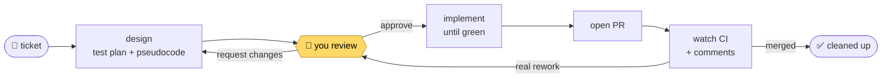

<div align="center">

# ℞ pi-rx

### Ticket in, merged PR out, and you approve the design before any code is written.

<p>
  
  
  
  
  <a href="./LICENSE"></a>
</p>

<p>
  <a href="#-why-its-opinionated">The story</a> ·
  <a href="#-quick-start">Quick start</a> ·
  <a href="#-how-a-ticket-flows">How it flows</a> ·
  <a href="#-works-best-with">Works best with</a> ·
  <a href="#-ticket-sources">Ticket sources</a> ·
  <a href="#-commands">Commands</a>
</p>

</div>

## 📖 Why it's opinionated

Coding agents are eager. Hand one a ticket and it starts writing code right away, and if its
approach is off, you only find out by reading the diff. Then the back-and-forth starts: fix this, not
like that, undo that part. The code is rarely the real problem. **The plan is, and you only get to see
it after it has been turned into code.**

So Rx flips the order. Before writing a single line, the agent has to:

1. **Write the test plan first.** Deciding up front how the change will be proven changes how the agent
   writes it. It knows the edge cases, the failure paths, and what "done" means before it starts, and
   the code comes out shaped to pass those tests rather than patched until it does.
2. **Write the design as plain-language pseudocode**, a tree you can read in a minute, and show it to
   you.

You argue with the plan while it's cheap to change. Once you approve it, the agent implements against
something both of you agreed on.

In my experience that's the difference: **tasks now land in almost a single shot.** The review that
used to happen across five rounds of diffs happens once, on one page, before any code exists.

That's also why Rx is opinionated. It works because of the order it insists on: test plan, design,
your approval, then code. It isn't a loose toolkit you assemble yourself.

## 🩺 What it does

```text
/rx ENG-1234
```

That's it. Rx sets up an isolated worktree, writes a test plan and a **pseudocode design**, and puts
that design in front of you. Nothing gets implemented until you approve it. After that it writes the
code, opens the PR, and watches CI and review comments until the PR merges.



> [!NOTE]
> Rx also works best with a handful of tools ([Co-Review](https://sdsvn.github.io/co-review/), [Herdr](https://herdr.dev/), [ntfy.sh](https://ntfy.sh) and others). **None of them are
> required**: without each one, Rx falls back to something simpler. See [Works best with](#-works-best-with).

## ✨ What you get

|   |   |
|---|---|
| 🧭 **You review the design, not just the diff** | The agent stops at a gate with a plain-language pseudocode tree. Code happens only after you approve it. |
| 🔒 **The gate is real** | Every phase change goes through one guarded tool that refuses invalid jumps, so the agent can't skip review. |
| 🧹 **Nothing lands in your project** | State, design docs, and specs live under `~/.claude/workflow/`, keyed per repository. |
| 📈 **It learns from your corrections** | Every rejection, rework, and requested change is logged with its reason. `/rx-retro` turns patterns into fixes. |
| 🪶 **Tiny footprint** | One TypeScript file plus markdown playbooks. No dependencies, no build: omp runs the source. |

## 🚀 Quick start

**1. Clone**

```bash
git clone https://github.com/sdsvn/pi-rx ~/projects/pi-rx
```

**2. Register it with omp** in `~/.omp/agent/config.yml`. The `skills` entry loads the bundled
`pseudocode-design` skill, which Rx uses for its design docs:

```yaml
extensions:
  - ~/projects/pi-rx
skills:
  enabled: true
  customDirectories:
    - ~/projects/pi-rx/skills
```

**3. Go.** Restart omp, then from inside any git repository:

```text
/rx ENG-1234                          # a Linear ticket (or its URL)
/rx #123                              # a GitHub issue
/rx add retry to the webhook sender   # or just say what you want
```

A plain-text task gets a short id (`add-retry-webhook-sender`); type it again, even reworded, and Rx
picks up the same task. Using Jira, GitLab or something else? [Set your ticketing system](#-ticket-sources).

`/rx` is the only command you need to remember. It sees where the ticket is and runs the next step.

**Requirements:** omp / pi, `git`, and `gh` (signed in).

## 🔄 How a ticket flows

**1 · Start.** Creates `.worktrees/ENG-1234` on branch `ENG-1234`, reads the ticket, and writes a test
plan, a pseudocode design, and (with [OpenSpec](https://openspec.dev/)) spec deltas. It writes no code.

**2 · Review.** The design opens for you as soon as it's ready:

- **In Co-Review**, if it's installed: comment on any step, get answers in the thread, and Submit with
  *Approve* or *Request changes*.
- **As a local HTML page** otherwise, with comment buttons, *Approve*, and *Request changes*.

Your comments go straight to the agent. It answers questions and edits the design, and the review
updates live. *Request changes* (or `/rx-reject ENG-1234 "why"`) starts another round.

**3 · Implement.** *Approve* (or `/rx-approve`) implements against the approved design and runs the
verification loop until it's green.

**4 · Ship.** `/rx-pr` opens the pull request. Inside [Herdr](https://herdr.dev/), a watcher then keeps an eye on it: it fixes
red CI and trivial comments itself, answers threads, and sends real changes back to the design gate
with `/rx-rework`.

**5 · Clean up.** Once merged, `/rx-cleanup` removes the worktree, branch, watcher, and artifacts, and
archives the spec deltas.

> [!TIP]
> Changed your mind? `/rx-abort ENG-1234` abandons a ticket at any phase and tears everything down.

## 🧩 Works best with

All optional. Here's what each one adds and what you get without it.

| | What it adds | Without it |
|---|---|---|
| 🔍 **[Co-Review](https://sdsvn.github.io/co-review/)** | Design review in a native app, with threaded comments the agent replies to. | A local HTML review page (needs `python3`). Same gate, but no reply threads, so the agent answers in chat. |
| 🪟 **[Herdr](https://herdr.dev/)** + `jq` | A workspace per ticket, plus a PR watcher that fixes CI and trivial comments on its own. | No watcher. You check the PR and run `/rx-rework` or `/rx-cleanup` yourself. |
| 📱 **[ntfy.sh](https://ntfy.sh)** via pi-notify | Phone notifications when Rx is waiting on you. Reply "approve" from your phone. | You check back in the terminal. |
| 📋 **Linear MCP** | `/rx ENG-1234` and Linear URLs read the ticket directly. | Use GitHub issues, plain text, or [your own ticket source](#-ticket-sources). |
| 📜 **[OpenSpec](https://openspec.dev/)** | Durable spec deltas per change, archived on merge. | The spec step is skipped. |

> [!IMPORTANT]
> Install Co-Review for the best review experience. Rx tells you when it's falling back to the HTML page.

## 🎫 Ticket sources

Rx isn't tied to Linear. Tell it which ticketing system you use, and it fetches tickets from there.

### Pick your ticketing system

Put a `.rx/config.yml` in your repo (commit it and the whole team gets it), or
`~/.config/rx/config.yml` for yourself:

```yaml
tickets: jira                  # your default: linear (default), jira, github, gitlab, or your own
ticket_shape: ^(PAY|OPS)-\d+$  # optional: what your ticket ids look like
```

- **`tickets`**: bare ids like `PAY-123` go to this system. URLs always go to the system they
  belong to, so a Linear link still works when Jira is the default.
- **`ticket_shape`**: a regex for your ids, case-insensitive. Without it, anything shaped like
  `KEY-123` is a ticket. Set it when your ids look different, or so that only your own projects
  count. The id is the whole match, or the `(?<id>…)` group if there is one: GitLab-style `#123` is
  `tickets: gitlab` with `ticket_shape: ^#(?<id>\d+)$`.

The repo's config wins over yours.

### Bundled sources

| Source | Recognises | Fetches with |
|---|---|---|
| [`linear`](./sources/linear.md) | `ENG-1234` (the default), `linear.app/…/issue/ENG-1234` | Linear MCP `get_issue`, or the `linear` CLI |
| [`jira`](./sources/jira.md) | `PROJ-123` with `tickets: jira`, `…atlassian.net/browse/PROJ-123` | Atlassian MCP `getJiraIssue`, or a Jira CLI |
| [`github`](./sources/github.md) | `#123`, `gh-123`, `owner/repo#123`, issue URLs | `gh issue view` |
| [`gitlab`](./sources/gitlab.md) | `gl-123`, issue URLs (`#123` with the shape above) | `glab issue view` |
| [`text`](./sources/text.md) | anything else | your own words are the requirement |

### Add your own

A source is a small markdown file: patterns that recognise what you typed, and a prompt telling the
agent how to fetch the story. Put it in `.rx/sources/<name>.md` (repo) or `~/.config/rx/sources/`:

```markdown
---
name: shortcut
description: Shortcut stories — sc-123 or a story URL.
match:
  - ^https://app\.shortcut\.com/[^/]+/story/(\d+)
  - ^sc-(\d+)$
id: sc-$1
---
Fetch Shortcut story **$ID** (number $1) from the Shortcut API:
`curl -s -H "Shortcut-Token: $SHORTCUT_API_TOKEN" https://api.app.shortcut.com/api/v3/stories/$1`.
**title** = the story name. **requirement** = its description, word for word.
Not found? Ask the user to paste it.
```

- **`match`**: regexes tried on the first word you type (`flags: i` for case-insensitive).
- **`id`**: the pipeline id built from the regex groups (`$1`); `case: upper` uppercases it. It names
  the branch and the worktree.
- **The body**: how to fetch the story, with `$ID`, `$REF` (exactly what you typed) and the groups
  `$1`…`$9` filled in. End by saying what the **title** and **requirement** are.

To send bare ids to it, set `tickets: shortcut` with a `ticket_shape` for them. A source with the same `name` as a bundled one
replaces it, so you can also rewrite how Linear tickets are fetched.

## ⌨️ Commands

| Command | |
|---|---|
| `/rx [ticket \| url \| text]` | **Run the next step.** Bare `/rx` drives the current ticket. Inside Herdr, it gives every active ticket its own workspace. `/rx approve`, `/rx status`, `/rx reject "why"`… run that step on the current ticket. |
| `/rx-review` | Reopen the design review (it opens by itself at the gate). |
| `/rx-approve` · `/rx-reject "notes"` | Approve the design, or push back on it. |
| `/rx-rework "summary"` | The PR needs real changes: back to the design gate. |
| `/rx-abort` | Abandon the ticket at any phase. |
| `/rx-status` | Every ticket in this repo, at a glance. |

<details>
<summary><b>All commands</b></summary>

<br>

| Command | What it does |
|---|---|
| `/rx-start` | Worktree, test plan, and design; stops at the approval gate. |
| `/rx-pr` | Open the PR, or push a rework to the existing one. |
| `/rx-cleanup` | After merge: tear down and archive. |
| `/rx-retro` | Find recurring corrections in the deviation log. |
| `/rx-improve [topic]` | Fix the highest-value item in the workflow backlog. |
| `/rx-panel` | Toggle the phase panel under the editor. |

`/task …` and `/flow …` work as aliases for `/rx …`.

</details>

## 🗂️ Where things live

Nothing goes into your project. Everything is under `~/.claude/workflow/`, per repository
(`<repo-key>` = repo name + a checksum of its path):

```text
~/.claude/workflow/
├── state/<repo-key>/<ticket>.json     phase, branch, worktree, PR, review state, audit log
├── artifacts/<repo-key>/<ticket>/     design doc + review diffs (removed at cleanup)
├── openspec/<repo-key>/               your personal OpenSpec store
├── deviations/<repo-key>.jsonl        logged corrections, mined by /rx-retro
└── DECISIONS.md                       standing objections from /rx-reject
```

<details>
<summary><b>⚙️ Configuration</b></summary>

<br>

No config file. Optional environment variables:

| Variable | Effect |
|---|---|
| `RX_REVIEW_BIN` / `CO_REVIEW_CLI` | Path to the `co-review` CLI when it isn't on `PATH`. |
| `RX_PSEUDOCODE_SKILL` | Where the `pseudocode-design` skill lives, if not in this repo's `skills/` or `~/.claude/skills/`. |

</details>

<details>
<summary><b>🛠️ Development</b></summary>

<br>

- `src/index.ts` is the extension: the state machine, the `rx_*` tools, the review, and the panel.
- [`stages/`](./stages) holds the playbooks the agent follows at each step.
- [`workflow/`](./workflow) holds the docs those playbooks read.

omp runs the source directly, so restart or reload omp to pick up an edit.

Sanity check (state machine + repo-key checksum parity with the system `cksum`):

```bash
printf 'import {demo} from "%s/src/index.ts"; demo()\n' "$PWD" > /tmp/rx-demo.ts && bun run /tmp/rx-demo.ts
# → pi-rx demo: OK
```

Before changing the workflow, read [`workflow/WORKFLOW.md`](./workflow/WORKFLOW.md) (summary,
invariants, backlog). Every tool and surface is documented in
[`workflow/REFERENCE.md`](./workflow/REFERENCE.md).

</details>

## 📄 License

[MIT](./LICENSE)
