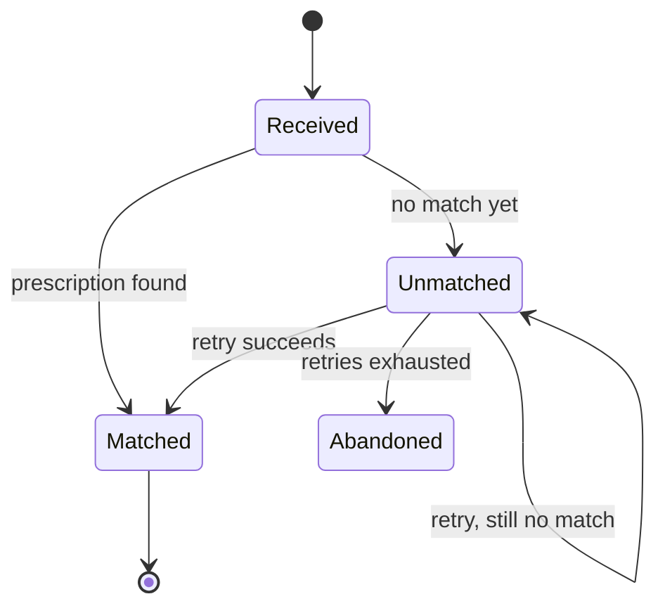

# Hierarchical Pseudocode Design

Put a reviewable design layer between **requirements** and **code** so the human corrects
architecture, boundaries, and naming *before* they become a schema, a data layer, a handler, and
their tests. A wrong decision caught in the tree costs seconds; caught in code it costs an unwinding
of hundreds of lines.

```
requirements → hierarchical pseudocode → human verifies → implement → code ↔ pseudocode check
```

**Optimize for minimizing expensive human review, not time-to-first-code.** Move decisions *up* the
abstraction hierarchy. Keep the design visible. Expand only when asked. Implement only after the
important decisions are understood.

## Non-negotiables

Locked user decisions. Every design this skill produces obeys ALL of these; do not soften, trade
off, or relitigate them when refining this skill or its output:

1. **Nested markdown list** — plain natural-language steps. Never box-drawing trees, never
   procedural keywords (`FUNCTION`/`IF`/`RETURN`), never prose paragraphs.
2. **ONE list** — L2 nests inside its L1 bullet, L3 inside L2. Never separate sibling blocks.
3. **L1–L2 suffices, L3 at most** — never deeper in a design; L4+ only on explicit request.
4. **Business language at the top** — abstraction registers respected; technical detail never
   leaks above L2.
5. **`complexity === number of points`** — bullet count is a budget; decision-free steps are one line.
6. **No far-away sections** — no separate Data Model / Interface / Naming / Mapping sections; every
   decision lives inline in the list at the step it belongs to.
7. **Diagrams outside the main list**, only for shapes that matter (state machines, multi-actor);
   the list stays canonical.
8. **Open questions drain to zero, driven by the agent** — proactively ask the human each `?` with
   a recommendation; answered → folded in, or out of scope only with explicit agreement. Never
   silently dropped or left parked in the file; no approval while one is open.
9. **The HTML review view is served live and opened unprompted** for every medium+ design —
   collapsible abstraction levels, L1/L2/L3 toggle, per-node comments and the general chat box,
   feedback file watched; the markdown stays canonical. Static file only as fallback.
10. **≤4 children per node (abstraction thumb-rule)** — any bullet's direct sub-list holds **at
    most 4 items**. More than 4 means the parent is at the wrong altitude: regroup into fewer,
    higher-abstraction bullets (or push detail down a level), never let one node sprawl. This
    keeps every level scannable and forces the design *up* the hierarchy. Applies to every
    sub-list (L2 under L1, L3 under L2); the root's top-level steps may exceed 4 when each maps to
    a distinct deliverable/acceptance-criterion and merging would force illegal L4 depth (#3) —
    flag that case to the human rather than over-nesting.

## What "pseudocode" means here

Plain, readable steps rendered as a **nested markdown list** — the flow of the design in short natural
phrases, not code and not prose paragraphs. Branches (*if …*), loops (*for each …*), and returns
appear as plain language, not keywords. **Nesting depth is altitude; a sublist is a zoom.**

```
  ▲ HIGHER = shallow nesting, steps are single named actions. Start here.
  │                                                        register
  │  L0  Feature         the capability, one line          business / domain
  │  L1  Architecture    the top-level steps and flow      business / domain
  │  L2  Component       expand one step's real work       mixed: domain + technical
  │  L3  Behavioral      branches/loops, edge & errors     technical
  │  L4  Implementation  concrete signatures / calls       code-level  ·· on request
  │  L5  Code            the real thing                    code
  │
  ▼ LOWER = deeper nesting, more of it. Expand only the bullet asked about.
```

Do **not** descend a level just because you can. The human decides which bullet to expand.

The ladder deliberately parallels the **C4 model**'s zoom: L0–L1 ≈ *System Context* (audience:
anyone, including non-technical), L2 ≈ *Container/Component* (technical staff), L3+ ≈
*Component/Code* (developers). C4 zooms through structure (boxes); this ladder zooms through
behavior (steps) — same discipline, different axis. Keep the L-names for the list; reach for C4's
diagram types when the *structure* itself needs review (below).

**Respect the register of each level.** The top levels read in **business / domain language** —
what happens in the problem, phrased so a non-engineer stakeholder could follow it. Technical detail
(HTTP status, table names, retries, signatures, timeouts) belongs at **L2 and below**, never leaked
up. If a top-level bullet mentions `401` or a column name, it's at the wrong altitude — raise it to
the domain action ("reject events we can't trust") and let the detail appear when that bullet is
expanded. (No business framing? A pure infra/library task can start technical — use judgement.)

## Notation

The structure is a **markdown bullet list**; indentation is scope. One consistent shape so any reader
scans it at a glance:

- **ONE list.** L2 nests *inside* its L1 bullet, L3 inside its L2 bullet — never as separate
  sibling blocks. Depth on the page IS the altitude; the reader never jumps between lists.
- **Bullet count is a complexity budget** — `complexity === number of points`, capped at **≤4
  sub-bullets per node** (non-negotiable #10). A step with no real decision is ONE line, however
  much mechanical work it hides; only decision-carrying steps earn sub-bullets. If a node needs a
  5th child, two of its points are really one — merge them, or the node is too low and should
  regroup upward. If two bullets say the obvious, merge them or cut one.
- **One step per bullet**, a short phrase. A bullet needing a paragraph is hiding a sublist — expand it instead.
- **Branches and loops in plain words**: `if large →`, `for each page →`, `on failure →`. No uppercase keywords, no language syntax.
- **Reasoning rides after an em dash**, on the same line: `respond 200` — don't make the provider retry a parse bug. Never nest prose as its own bullet.
- **Altitude tags** (`**L2** · ingest`) only when showing an isolated zoom in conversation; in the
  artifact's single list, depth already says it.

Inline markers — the reader's attention goes exactly where these are:

- `?` open decision, not yet resolved
- `⚠` deviation from precedent or a deliberate rule-bending exception — needs a human call
- `✎` a name being proposed (surfaces a naming decision)

No status markers — the pseudocode is written *before* the code, so per-step planned/done tracking
is noise; implementation progress lives in the repo, not the design.

## What it looks like

One worked example — the pharmacy sends us prescription events. ONE list: depth 1 is L1 (domain
language, no HTTP or table names), and zooming expands a bullet **in place**. Note the budget: the
two trivial steps stay one line each; only the step hiding decisions grew a sublist.

- a pharmacy event arrives
  - make sure it really came from the pharmacy — ignore anything we can't trust
  - record that we received it
    - `✎` store in `webhook_events` — new table; a RECEIVED event, not final state; `external_event_id` unique → dedupes resends
    - duplicate or malformed → accept anyway (store raw + flag) — never make the pharmacy retry over a parse bug
    - database unavailable → respond `503` — `⚠` only case we let the pharmacy retry
  - acknowledge receipt so the pharmacy stops resending
- later, match the event to a prescription — `?` matching key still open (Q1)

The reviewer approves the depth-1 flow in business terms without reading deeper; `?` and `⚠` mark
exactly where attention is needed. Expanding one bullet never disturbs its siblings — that *is* the
review. (In conversation, a zoom may be shown as an isolated block tagged `**L2** · record the
received event`; in the artifact it always lives nested in the one list.)

## Diagrams where a list can't

A nested list is inherently **sequential**. When the design's shape is not — cycles, many actors,
concurrent lifecycles — a list hides exactly the structure the reviewer needs. There, add a
**mermaid diagram** next to the list. Pick by shape, not by taste:

| Shape of the problem | Diagram |
|---|---|
| states + transitions (order lifecycle, job status) | `stateDiagram-v2` |
| several actors exchanging messages (client ↔ service ↔ provider) | `sequenceDiagram` |
| component topology with fan-out / cycles | `flowchart` |
| the change spans systems/services and WHERE things live is the decision | C4: `C4Context` / `C4Container` (mermaid) |
| entities + relationships (only when the data model is the decision) | `erDiagram` |

A C4 diagram obeys the ladder too: show the C4 level that matches the list's current altitude —
a Context diagram beside an L1 list, a Container diagram when zoomed to L2 — never deeper.

Rules:

- **The list stays canonical.** A diagram is a projection of one aspect (the states, the handshake);
  zooming, markers, and approval still happen on the list. Never let them disagree.
- **Same register discipline.** A diagram shown at L1 uses domain names ("Payment taken"), not table
  columns or status codes.
- **No decoration.** A linear flow, or anything ≤ 3 nodes, never gets a diagram — a list already
  shows it. A diagram must reveal structure the list can't, or it's noise.
- Diagrams live in the artifact's **Diagrams** section, right after the list — never scattered.

Example — the webhook event's lifecycle has a cycle (retrying an unmatched event) a list can't show:



Open decisions about the diagram (here: `?` retry cadence, Q-numbered under Open Questions) stay on
the canonical list, not in the diagram.

## Size scales with complexity

The design's size is **proportional to the task's complexity**, never fixed. Match the effort to the
decisions actually at stake — a heavy tree on a trivial change is the exact over-review this skill
exists to prevent.

- **Trivial** (one-liner, rename, obvious local edit) → **no pseudocode**. Say so and just do it.
- **Small** (one component, no new boundaries/data/naming) → a few L1 lines inline in chat; no artifact file.
- **Medium** (a few components, some new names or state) → L1 + L2 for the parts with real decisions; write the artifact.
- **Large / cross-cutting** (new tables, events, cross-service ripple, migrations) → full artifact, L1→L2, L3 on the branches that carry risk.

Depth is per-subtree, not global: expand only the branches that hide a decision, leave the mechanical
ones shallow. When unsure, start smaller and let the human ask you to go deeper.

## The artifact

For medium+ tasks, keep one canonical Markdown file per feature. If the surrounding workflow or caller
gives you an exact artifact path, use that path verbatim and do not create a second copy. Otherwise
follow the repo's existing planning/design-doc convention (for example `docs/design/` or beside the
ticket notes); if there's no convention, `docs/design/<feature>.pseudocode.md`.

**Four sections, nothing more.** The design is ONE list — everything lives inline in it, at the
altitude where it belongs. No separate Data Model / Interface / Naming / Behavioral-Rules sections
pulling a decision away from the step it belongs to; a new table is a `✎` bullet under the step that
writes it, an error rule is an L3 branch under the step that hits it.

```markdown
# Feature: <name>

## Context         — a short paragraph: the capability, in domain terms
## Design          — THE nested list, L1 → L2 (L3 only on risk-carrying branches)
## Diagrams        — only if the shape demands one (state machine, multi-actor); beside, never instead
## Open Questions  — every `?` from the list, numbered
```

If the surrounding workflow/tooling names an exact section contract, follow it verbatim. Otherwise
omit only truly empty optional sections rather than padding them. **Decision visibility, not
documentation volume** — if the file is longer than the decisions it carries, cut.

**Open questions must drain to zero — and YOU drive the drain.** A `?` is never parked: at every
review touchpoint, put each open question **to the human directly** as a pointed question with your
recommended answer — don't wait to be asked, and never end a design session leaving a `?` silently
in the file. Each question ends one of exactly two ways: **answered** — fold the answer into the
list and delete the question; or **out of scope** — only with the human's explicit agreement,
recorded as `out of scope (agreed <date/ticket>)`. A question never silently disappears, and the
design isn't approved while one is still open.

## Decisions must be visible

The artifact's job is to expose **decisions**, not just describe planned code. Instead of "create a
table for webhook events", write the reasoning as annotations a reviewer can challenge in place:

- `✎` new table `webhook_events` — a RECEIVED event, not resulting prescription state
  - `external_event_id` — unique, so resends are deduped (idempotency)
  - `prescription_id` — linked to prescription after resolution
  - *name:* repo names persistence tables as plural domain nouns; not coupled to a provider

Now the human can reject `prescription_webhook_records` before a migration exists.

## Naming is a first-class decision

Whenever you introduce a table, column, package, module, service, type, function, API, event, or
topic whose name is architecturally meaningful, surface it as a `✎` bullet inline in the list, at
the step that introduces it — don't bury it in implementation. **Inspect the repo's existing conventions before proposing** (naming
patterns, directory structure, DB/migration conventions, API/event naming, similar existing code) and
mirror them unless there's a deliberate reason to deviate. If you deviate, flag it loudly:

```
⚠ DESIGN DEVIATION
  Proposed:  webhook_events
  Precedent: external_events
  Reason:    <reason>
  → needs human confirmation
```

## The HTML review view — always, served live at review

If the surrounding workflow already owns review presentation or feedback transport, use that flow and
do **not** spin up a parallel server, alternate HTML path, or second artifact copy. Review still
must happen — just through the workflow's canonical surface. Otherwise every design that gets an
artifact (medium+) is presented for review as a **hosted, live HTML page — unprompted**.

Presenting a design for review means, every time:

1. **render:** `python3 scripts/render_html.py <artifact> --live -o "$TMPDIR/design.html"`
2. **serve:** run `python3 scripts/live_review.py "$TMPDIR/design.html" "$TMPDIR/feedback.jsonl"`
   as a background process — it prints the URL on stdout
3. open the URL in the browser and tell the human both the URL and the feedback file path
4. **pick up feedback and fold it in:** each line appended to `feedback.jsonl` is one piece of
   human feedback (node comments and the general chat box both land there). For every new line,
   fold it into the canonical markdown and re-run step 1 to the same path — the browser reloads
   itself within ~2s.

- **Portable baseline — works in any harness with a shell:** background the server
  (`… live_review.py … &`) and, between turns, re-read `feedback.jsonl`; remember how many lines
  you have already folded in and process only the new ones. Needs nothing but a shell and a file
  read — the lowest common denominator, so this is the fallback everywhere.
- **pi (Oh My Pi) upgrade — optional, pi-only:** if the `hub` tool is present, run the server as a
  supervised process (`hub start`) and `hub wait` on a `tail -f "$TMPDIR/feedback.jsonl"` job so a
  new feedback line *wakes* you instead of blind-polling. `hub` is a pi construct and does not
  exist in other agent runtimes — never make it the baseline; degrade to the portable loop above
  wherever it is unavailable.

**The abstraction levels themselves become collapsible**: every parent bullet is a `<details>`
element — L1 open, deeper levels collapsed, expanding a node IS "zoom into X" — plus an L1/L2/L3
toggle that opens the whole tree to a chosen altitude in one click. The page carries per-node 💬
comment buttons and a general chat box at the bottom for messages not tied to a node.

The **markdown artifact stays canonical** — the HTML is a one-way, disposable projection; decisions
taken in review are folded back into the markdown, never into the HTML. Never hand-author the HTML;
the scripts own it. **When review ends, tear the scaffolding down:** stop the server (kill the
background process, or `hub stop` if you started it under `hub`) **and delete the disposable review
files** — the rendered `design.html` and the `feedback.jsonl`. Keep every review file in `$TMPDIR`,
never in the repo or beside the artifact; if one ever lands in the repo (e.g. a harness that has no
writable `$TMPDIR`), remove it on teardown so only the canonical `.md` stays committed — the HTML and
feedback log are throwaway projections, not deliverables. See [HTML-VIEW.md](HTML-VIEW.md) for the
rendered spec and rules. (Small designs reviewed inline in chat need no HTML — no artifact, no view. A
static file — `render_html.py` without `--live`, opened directly — is the fallback only when a server
can't run or the human asks for a shareable file; delete it too once shared.)

## Navigation commands

Respond to how the human steers the tree — never dump lower levels unprompted:

| Command | Effect |
|---|---|
| **"zoom into X"** | expand only X's bullet into a sublist, one level down |
| **"explain X"** | reasoning behind X, expand nothing else |
| **"zoom out"** | collapse back to the parent bullet |
| **"show the architecture"** | L1 view — top-level steps only, no expanded bodies |
| **"show everything"** | full current design, all sublists expanded |

## Progressive refinement

Start with the **smallest useful** list (usually L1) — never dump a giant document up front. Refine a
bullet only when it's the one under discussion or it hides a real decision. The list behaves like an
expandable tree; approving the architecture must not require reading implementation detail.

## Interaction

1. **Understand** — use whatever ticket / issue / requirements step the project already has; don't
   duplicate it.
2. **Sketch** — produce the L1 helicopter view. No code.
3. **Review** — present: `here's the shape` + `decisions I made (1,2,3)` + `decisions I need you to
   verify (1,2)`. For medium+ designs, use the workflow's canonical review surface when one exists
   (for Rx, that means `/rx-review`, not an extra ad-hoc server); otherwise render the HTML, start
   the live server, and open the URL now, unprompted — then watch the feedback file alongside the
   chat.
4. **Refine** — expand only the bullet the human asks about.
5. **Ask** — actively put every open `?` to the human, one pointed question at a time with your
   recommended answer first (use the structured question tool when available). Do this unprompted —
   a `?` sitting in the file is a question you owe the human, not a note to self. Fold each answer
   into the list immediately; move a question to out-of-scope only on their explicit say-so.
6. **Approve** — when every `?` is answered or agreed out of scope, say so and get go-ahead. If any
   `?` remains, you are still in step 5 — there is no path to Approve around it.
7. **Implement** — translate the approved tree to code. Preserve the hierarchy.
8. **Verify** — reconcile code ↔ pseudocode (below).

**Verification gates** — ask for confirmation on unresolved decisions in: architecture, data model, API
behavior, package boundaries, naming, state transitions, backwards-compat, error behavior, concurrency,
security, migrations, external integrations. Do **not** gate on trivial implementation details — this
is decision review, not bureaucracy.

## During and after implementation

- The approved tree is the **contract**, not disposable planning. Don't silently introduce a major
  architectural decision that isn't in it.
- If implementation reveals a needed design change: **stop, update the tree, explain, and re-confirm**
  if the change is materially architectural.
- After implementing, reconcile both directions and report drift explicitly:

```
DESIGN DRIFT
  Pseudocode:     persist webhook AFTER validation
  Implementation: persists webhook BEFORE validation
  Reason:         <reason>
  → update the tree OR change the code
```

Keep the pseudocode alive after merge as the architectural map of the feature.

## Anti-pattern this replaces

`Implement feature X` → 500 lines of code → human asks "why did you create this table?" — that review
is expensive and late. Surface the table, its name, and its reasoning as a tree first; implement only
after the important decisions are understood.
