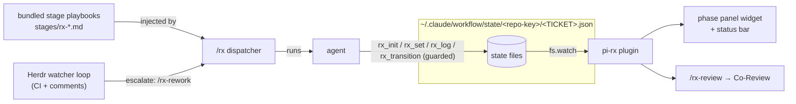

# pi-rx — reference

The detailed surface-by-surface reference. Start with the [README](../README.md).

Gated Rx workflow companion for pi — **self-contained**. The plugin owns the phase state machine,
all state mutation (the `rx_*` tools), the Co-Review design review (over Co-Review's MCP tools), the stage playbooks
(bundled in [`stages/`](../stages)), and the workflow docs those playbooks read — bundled in
[`workflow/`](.) (`WORKFLOW.md`, `HISTORY.md`, `pr-description-style.md`, `watcher.md`) and resolved
in-playbook via the `$RX_PLUGIN` token (→ plugin root). State lives at `~/.claude/workflow/state/<repo-key>/<TICKET>.json`
(created and mutated only through the tools). There is no external bash `rx-lib.sh` and no
`~/.claude/commands/rx-*.md` dependency — both were retired into this plugin.

## State machine

```mermaid
stateDiagram-v2
    [*] --> started : /rx-start
    started --> awaiting_approval : design ready (test plan + pseudocode)
    awaiting_approval --> awaiting_approval : Request changes / reject (design_rev++)
    awaiting_approval --> approved : Approve (/rx-approve)
    approved --> implemented : verify loop green
    implemented --> pr_open : /rx-pr (opens PR, or pushes to existing PR after rework)
    pr_open --> awaiting_approval : /rx-rework "substantive comments"
    pr_open --> cleaned : /rx-cleanup (after PR merged; watcher detects merge)
    started --> aborted : /rx-abort
    awaiting_approval --> aborted : /rx-abort
    approved --> aborted : /rx-abort
    implemented --> aborted : /rx-abort
    pr_open --> aborted : /rx-abort (abandon; PR not merged)
    aborted --> [*]
    cleaned --> [*]

    note left of awaiting_approval
        /rx-review serves the pseudocode + OpenSpec
        in Co-Review; the reviewer's Submit
        drives the gate — approve implements,
        request-changes bumps design_rev and revises
    end note
    note right of pr_open
        Herdr watcher loop owns this phase:
        fixes trivial CI/comments itself,
        escalates real work to /rx-rework
    end note
```

State names use `-` in the JSON (`awaiting-approval`, `pr-open`); mermaid ids use `_`.

## What it adds

| Surface | What it does |
|---|---|
| Command `/rx` | **Phase-aware dispatcher — the only command you need.** Accepts: an id this repo already tracks; anything a **ticket source** recognises (`sources/*.md` bundled — Linear ids/URLs, GitHub `#123`/`gh-123`/URLs — plus `.rx/sources/` in the repo and `~/.config/rx/sources/`, tried in that order; the matched source's prompt becomes `/rx-start` §1 via `$RX_SOURCE`); or a **free-text task** (`/rx add retry to the webhook sender` → `add-retry-webhook-sender`, its text *is* the requirement; the same task reworded reuses it, a different one with the same slug gets `-2`). What was asked is recorded at once (`<ticket>.intake` in the state dir) and folded into the state by `rx_init` (`source`, `source_ref`, `requirement`); `/rx-start` then saves `title` + `requirement`. `/rx approve`, `/rx status`, `/rx reject "…"` (any stage word) run that stage on the current ticket instead of starting a task. **Bare `/rx` inside Herdr reconciles the whole project**: every active (non-`cleaned`) ticket without a live Space gets one — created at the repo root (`/rx` is worktree-aware) and opened by a freshly-launched **omp** (`herdr pane run "omp '/rx <ticket>'"`) that *lands* on the ticket (binds this session to it and shows status — it does **not** resume an old transcript or auto-advance a gate; signalled by a seeded `RX_LAND` env) — while the ticket owning your current pane is driven forward in place. Outside Herdr, bare `/rx` just drives the current ticket. Gates ask: at `awaiting-approval` you choose approve/reject (objection prompted); at `pr-open` you choose rework/cleanup. It injects the matching **bundled** stage playbook (`stages/rx-*.md`) with `$1`/`$2` filled in. |
| Stage commands `/rx-start` `/rx-approve` `/rx-reject` `/rx-pr` `/rx-cleanup` `/rx-rework` `/rx-abort` `/rx-improve` `/rx-retro` `/rx-status` | The explicit per-stage entries (also what `/rx` and notify replies name). Each injects its bundled `stages/rx-<cmd>.md` playbook via the same dispatcher. The playbooks drive state through the `rx_*` tools — no bash `rx-lib.sh`. **`/rx-abort`** is the escape hatch: abandon a ticket at any non-terminal phase (`started`…`pr-open`), tearing down its worktree, branch, watcher, and artifacts and moving it to the terminal `aborted` phase (distinct from `cleaned` = merged). |
| Command `/rx-review` | **Opened by the stages themselves** through its tool form `rx_review_open` (end of `/rx-start` and `/rx-rework`, interactive sessions only; `rx_transition` into the gate reminds the agent to call it); run `/rx-review` by hand only to reopen a closed review. **Opens the ticket's disposable artifact directory in [Co-Review](https://sdsvn.github.io/co-review/)** (`~/.claude/workflow/artifacts/<repo-key>/<ticket>/` — the `*.pseudocode.md` design doc plus any `*.diff` staged there), with the ticket's OpenSpec change attached when present. It talks to Co-Review only through its **MCP tools**, via `co-review mcp <repo>` (stdio; it starts the Co-Review app on the first call — `co-review` on PATH from Co-Review's installer, or `RX_REVIEW_BIN` / `CO_REVIEW_CLI`): `open_review` opens the dir (`storePath` = `<ticket>.review.json` in the state dir, which `rx_status` reads), then a background `await_reviewer` loop delivers each new comment to the session and drives the gate on the reviewer's **Submit** (approve → `/rx-approve`, request changes → design-revise self-edge, a plain comment → folded as a note). The review id is recorded as `review_id`, so a re-run (or a reply after a reload) rejoins the same review; Co-Review re-reads the doc off disk. `rx_review_reply` answers through Co-Review's `reply` tool. **On a re-review it surfaces WHAT CHANGED on top of the approved design**: the plugin snapshots the pseudocode when it's approved (`<ticket>.pseudocode.approved.md`) and, before each review, writes a unified diff (approved → current) as `<ticket>.design-changes.diff` + a titled sidecar, which Co-Review shows as a **"Design changes since approved"** diff page beside the plan. **Without Co-Review** (no `co-review` on PATH and no `RX_REVIEW_BIN`/`CO_REVIEW_CLI`) it falls back to the pseudocode-design live HTML page (`render_html.py --live` + `live_review.py` on a free `127.0.0.1` port, `python3` required; skill found via `RX_PSEUDOCODE_SKILL`, the plugin's `skills/`, this repo's `skills/`, or `~/.claude/skills/`): comments and Approve/Request-changes feed the same gate, the page re-renders on every pseudocode edit, and there are no reply threads (the agent answers in chat). The notice recommends installing Co-Review. |
| State tools | `rx_status` (read a ticket's state + repo/artifacts/openspec paths + review state, or list all — `details.paths.artifacts_dir` is the disposable out-of-repo dir Co-Review opens), `rx_init`, `rx_set`, `rx_log`, `rx_transition` (guarded — refuses any edge not in the diagram), `rx_deviation`, `rx_openspec_ensure`, `rx_ground` (fetch origin/main + base-freshness), `rx_pseudocode_check` (render-contract gate), `rx_review_open` (tool form of `/rx-review`), `rx_review_reply`. These are how the stage playbooks own state; there is no bash state layer. |
| Lifecycle (tools) | The plugin owns the git/CLI mechanics so the playbooks call ONE tool, never re-emit bash. **`rx_worktree`** creates/reuses the ticket's isolated worktree at `.worktrees/<ticket>` on branch `<ticket>` off `origin/main` (`skill://using-git-worktrees`: resolves the MAIN repo root so it works from any cwd/worktree, verifies `.worktrees/` is git-ignored and adds + commits it if not, idempotent). **`rx_watch_start`** (inside Herdr) renders the bundled `watcher.md` + a loop driver into the ticket's artifact dir and opens an `rx-watch` tab in the ticket's Space (`herdr_workspace`) running a self-scheduling loop — a cheap `gh` pre-check each cadence that only then wakes a fresh `omp -p` tick — recording `herdr_watch_tab`/`herdr_watch_pane`. It's **idempotent + self-healing**: a live watcher is reused, a dead one recreated (also reconciled when `/rx` lands a `pr-open` ticket). **`rx_watch_stop`** closes the tab (ends the loop). **`rx_teardown`** (cleanup) does that plus worktree/branch/remote removal and sweeps the review store + artifact dir. **`rx_deviations`** aggregates the deviation log for `/rx-retro`. All shell-outs are best-effort. |
| PR watcher loop | Each cadence the driver (`<artifacts>/<ticket>.watch.sh`) takes one GraphQL snapshot of the PR — review threads, PR comments, review bodies — and joins it with the durable disposition ledger `~/.claude/workflow/state/<repo-key>/<ticket>.watch.jsonl` via [`workflow/watch-items.jq`](./watch-items.jq). Keys carry their id space (`t:`/`c:`/`r:`). An item is **owed** while it's unresolved/unanswered and has no disposition since its last comment; the pane prints the items table (key, author, when, where, status, last action, note) every cadence, and the loop wakes an `omp -p` tick only for CI red, a conflict, or an owed item. The tick answers through `watch.sh reply <key> fixed\|replied "<body>"` (posts with a hidden `<!-- rx-watch -->` marker + records) or `watch.sh record <key> human\|rework\|skip "<why>"`. After each tick the loop re-reads GitHub and logs any still-owed item `unhandled`; `human`/`unhandled` items are re-asked hourly. `watch.sh show` prints the table on demand; `rx_status` returns the ledger as `details.paths.watch_ledger`. |
| PR & spec (tools) | **`rx_pr`** opens the PR (pushes + `gh pr create` from your authored title/body, records `pr_number`) or pushes a rework (+ optional comment), then moves the pipeline to `pr-open`. **`rx_pr_state`** reads the merge state via `gh` (the `/rx-cleanup` gate). **`rx_openspec`** runs the deterministic OpenSpec ops against the personal store — `validate` (strict), `archive` (fold deltas into baseline specs), `show` (JSON) — the store id is resolved for you. **`rx_decision`** appends a dated, ticket-tagged standing objection to `~/.claude/workflow/DECISIONS.md`. |
| Phase panel | Widget below the editor, one line per active ticket: `rx ENG-1234 ▸ pr-open #123 → /rx-rework \| /rx-cleanup`, plus a status-bar entry. Auto-refreshes via `fs.watch` on the state dir, so every `rx_*` tool write appears live. Hidden when the repo has no pipelines. |
| Command `/rx-panel` | Toggle the panel. |
| Herdr Space (per ticket) | When pi-rx runs inside a **Herdr** pane (`HERDR_ENV=1`), each active ticket gets its **own** Space (a sidebar "Space"), labeled `<ticket> · <stage>` with `stage`/`ticket`/`project` metadata tokens. It **labels the enclosing Space** after the ticket this pane drives — on `session_start`, every `/rx` dispatch, and every state change (`fs.watch` / `rx_transition`) — and **creates** a dedicated Space (`herdr workspace create` at the **repo root**, seeding an `RX_LAND` env) for any other active ticket during the bare-`/rx` fan-out, launching omp in it via `herdr pane run "omp '/rx <ticket>'"` (the initial message runs after omp fully inits, so it never races the splash; `RX_LAND` makes that `/rx` bind the fresh session to the ticket and show status rather than drive). Dedup trusts the persisted `herdr_workspace` id (via `workspace get`), falling back to a `<ticket> · ` label scan so Spaces survive a harness restart. `herdr workspace rename`/`report-metadata --source rx` expose tokens as `$stage`/`$ticket`/`$project` for sidebar templating. Best-effort no-op outside Herdr or without the `herdr` CLI. **There is no separate `/rx-resume` command** — a ticket bound to a past session is offered a reopen when you run `/rx <ticket>` interactively. |

## How it fits together

The plugin is the whole workflow: it bundles the stage playbooks (and the `workflow/` docs they read,
resolved via `$RX_PLUGIN`), injects them, owns state through the `rx_*` tools (guarded by
`rx_transition`), drives the Co-Review design review, and renders the panel. State files
are keyed per repo by `basename + POSIX cksum` of the main repo root — `demo()` proves that CRC matches
the system `cksum`.

Install, configuration and the check command: see the [README](../README.md).
